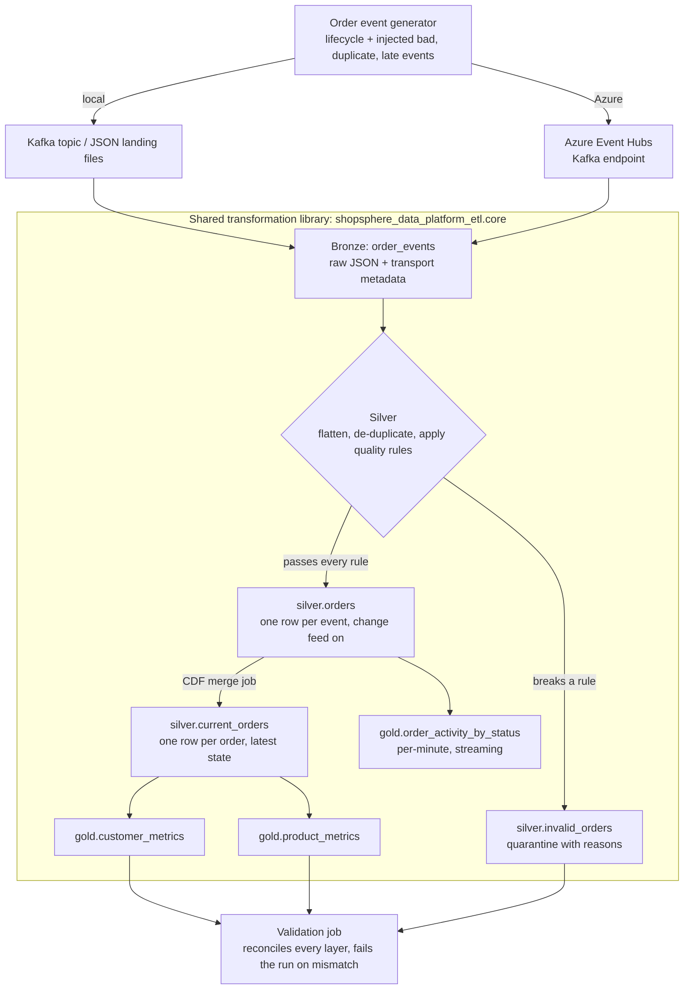

# ShopSphere Data Platform

[](https://github.com/Elisha-s/shopsphere-data-platform/actions/workflows/tests.yml)

A streaming data platform for an e-commerce order feed, built on the medallion
(Bronze / Silver / Gold) pattern. Order events are ingested, de-duplicated,
validated, merged into a current-state table and aggregated into business
metrics, and every run ends with a reconciliation that proves the layers agree.

The same transformation code runs in two places:

| Runtime | Ingestion | Processing | Orchestration | Use it for |
|---|---|---|---|---|
| **Local** (`local_pipeline/`) | Kafka, or JSON files | Open-source Spark Structured Streaming + Delta Lake | A Python runner | Running and demoing on a laptop, CI |
| **Azure** (`databricks_bundle/`, `orchestration/adf/`) | Azure Event Hubs | Databricks Lakeflow Declarative Pipelines + Unity Catalog | Azure Data Factory | The managed, production-style deployment |

The project started as the local version and was then migrated to Azure
([why](docs/design-decisions.md#why-two-runtimes)). The business logic was
pulled into one shared library so the two cannot drift apart.

## Architecture



Stage order, enforced by Azure Data Factory in the cloud and by
`local_pipeline/run_pipeline.py` locally:

**Bronze → Silver → CDF merge → Gold → Validation**

## What it demonstrates

- **Exactly-one-place data quality.** One rule set drives the Lakeflow
  expectations, the quarantine filter and the per-record failure reasons.
  Every event lands in `silver.orders` or `silver.invalid_orders`, never both,
  never neither.
- **Bounded-state de-duplication** of redelivered events with
  `dropDuplicatesWithinWatermark`.
- **Incremental, idempotent change processing.** The CDF merge job reads only
  unprocessed Delta versions, keeps the newest event per order by event time,
  and guards the MERGE so a late event cannot roll an order back.
- **Late and out-of-order data** handled deliberately at each layer.
- **Reconciliation, not hope.** Each run checks Bronze against Silver, Silver
  against current state, and Gold totals against their source.
- **A generator that exercises all of the above**: orders move through a
  lifecycle, and a configurable share of events is invalid, duplicated or late.
  The tests assert that the pipeline's counts match what the generator injected.
- **Deployment as code**: Databricks Asset Bundles with catalog-separated dev
  and prod, and a parameterised ADF pipeline with per-stage failure handling.

## Run it locally

Requirements: Python 3.10 to 3.12 and Java 17. On Windows, use the Docker
option or WSL (local Spark needs extra Hadoop binaries on native Windows).

```bash
python -m venv .venv && source .venv/bin/activate
pip install -r requirements.txt

# 1. Generate two hours of order events (about 5,000) as JSON files
python -m ingestion.run_producer --target files --max-events 5000 --backfill-minutes 120

# 2. Run Bronze -> Silver -> CDF merge -> Gold -> Validation
python -m local_pipeline.run_pipeline --source files

# 3. Look at the results
python -m local_pipeline.show_results
```

The first run downloads the Delta Lake libraries from Maven Central (about a
minute). `make demo`, `make show` and `make more` wrap the same commands.

Run step 1 again with fewer events and then step 2 again to see incremental
processing: only the new files are read, and only new Delta versions are merged.

### With Kafka, in Docker

```bash
docker compose -f local_pipeline/docker/docker-compose.yml up --build
```

This starts Kafka, a Kafka UI on <http://localhost:8080>, a producer sending
five events a second, and the pipeline running every 30 seconds.

More detail: [docs/running-locally.md](docs/running-locally.md).

## Deploy to Azure

The Azure resources are not kept running between demos, so deployment starts
from an empty subscription: [docs/deployment.md](docs/deployment.md).

```bash
cd databricks_bundle
databricks bundle deploy -t dev --profile <profile> --var adf_service_principal_id=<id>
```

## Tests

```bash
pytest             # fast: transformations, generator, streaming stages (no downloads)
pytest -m delta    # end to end on real Delta tables: change feed, MERGE, saved position
ruff check .
```

What each layer of tests covers, and what is not tested:
[docs/testing.md](docs/testing.md).

## Repository layout

| Path | What it is |
|---|---|
| `databricks_bundle/src/shopsphere_data_platform_etl/core/` | Shared business logic: schemas, quality rules, flattening, de-duplication, CDC, metrics |
| `databricks_bundle/src/.../transformations/` | Lakeflow pipeline definitions (thin wrappers around `core`) |
| `databricks_bundle/src/.../jobs/` | CDF merge job and validation job (run on Databricks and locally) |
| `databricks_bundle/resources/`, `databricks.yml` | Databricks Asset Bundle: pipeline, jobs, dev and prod targets |
| `orchestration/adf/` | Azure Data Factory pipeline definition |
| `ingestion/` | Event generator and producers (files, Kafka, Event Hubs) |
| `local_pipeline/` | Local Spark + Delta runner, results viewer, Docker setup |
| `tests/` | Unit tests and the end-to-end test |
| `docs/` | Architecture, data flow, design decisions, deployment, monitoring, testing |

## Documentation

- [Architecture](docs/architecture.md)
- [Data flow, table by table](docs/data-flow.md)
- [Design decisions and trade-offs](docs/design-decisions.md)
- [Running locally](docs/running-locally.md)
- [Deploying to Azure](docs/deployment.md)
- [Monitoring](docs/monitoring.md)
- [Testing](docs/testing.md)
- [ADF orchestration](orchestration/adf/README.md)
