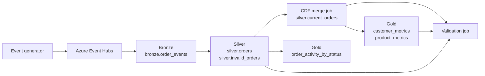

# ShopSphere Data Platform

[](https://github.com/Elisha-s/shopsphere-data-platform/actions/workflows/tests.yml)

A streaming pipeline for an e-commerce order feed, built on Azure with the
Bronze / Silver / Gold (medallion) pattern. Orders arrive as events, get
cleaned and de-duplicated, are rolled up into one current row per order, and
end up as customer and product metrics. At the end of every run a validation
job checks that the numbers in each layer agree with each other.

**Built with:** Azure Event Hubs, Azure Databricks (Lakeflow Declarative
Pipelines, Unity Catalog, Delta Lake and Change Data Feed), Databricks Asset
Bundles, Azure Data Factory, PySpark, GitHub Actions.

## How the data flows



Azure Data Factory runs the stages in this order: Bronze and Silver, the CDF
merge, Gold, validation. Gold has to wait for the merge because the customer
and product metrics are built from `silver.current_orders`.

## What each stage does

### Test data

Orders come from a generator, not a real shop. Each order
moves through a lifecycle (created, paid, shipped, delivered, or cancelled)
and every step is its own event. A small share of events is deliberately
broken: some are invalid, some are delivered twice, and some arrive minutes
late. That lets me check the pipeline against numbers I know are right.

### Bronze: keep everything that arrived

Spark reads Event Hubs through its Kafka-compatible endpoint. Each message is
stored as it came, with the raw JSON, the partition and offset, and the time
Event Hubs received it, next to the parsed fields. Nothing is filtered or
dropped at this stage, not even a message that isn't valid JSON. Bronze is the
record I can always go back to.

### Silver: clean and check

1. **Flatten.** The nested JSON becomes typed columns. A timestamp that can't be
   parsed becomes NULL instead of crashing the pipeline, and a rule catches it
   later.
2. **Remove duplicates.** Event Hubs can deliver an event twice, so repeats are
   dropped using the `event_id`. I use `dropDuplicatesWithinWatermark` with a
   one-day window, so Spark only has to remember a day of ids, not every id
   forever.
3. **Apply ten quality rules.** For example, quantity and prices must be
   greater than zero, `total_amount` must equal `quantity * unit_price`, the
   ids must be present, and the status must be one of the five known ones.
   Events that pass go to `silver.orders`. Events that fail go to
   `silver.invalid_orders` with the names of the rules they broke, so nothing
   disappears silently.

The ten rules live in one dictionary and are used for the Lakeflow
expectations, the quarantine filter and the failure reasons, so they can't get
out of step with each other.

### CDF merge: one current row per order

`silver.orders` has one row per event, so an order that went through four
statuses appears four times. The merge job builds `silver.current_orders`
with one row per order holding its latest state.

It doesn't re-read the whole table each time. `silver.orders` has Delta Change
Data Feed turned on, which lists only the rows added since a given table
version. The job remembers the last version it processed in a small state
table, reads the change feed from the next version, and keeps only the newest
event per order. Then it merges those into `current_orders`.

Two details matter here:

- **Late events can't overwrite newer ones.** "Newest" means event time, not
  the time the row was written. The MERGE only updates an order if the
  incoming event is newer than what's stored.
- **A retry is safe.** The saved version is only updated after the MERGE
  succeeds. If the job dies in between, the next run reads the same changes
  again and the MERGE changes nothing.

The first run has no saved version. Reading the change feed from version 0
failed on Azure (see below), so the first run reads a snapshot of the table
instead, and later runs use the change feed.

### Gold: numbers for the business

- `order_activity_by_status`: events per status per one-minute window,
  computed as a stream from Silver. A window is written once it is complete,
  so the latest ten minutes or so aren't in the table yet.
- `customer_metrics`: orders, lifetime value, average order value and last
  purchase per customer.
- `product_metrics`: units sold, revenue, orders and unique customers per
  product.

The last two are built from `current_orders` and only count orders that are
paid, shipped or delivered. Reading from `current_orders` rather than the
event table means an order is counted once, not once per status change.

### Validation: prove the layers agree

The validation job runs six checks and fails the run if any of them don't
pass. All six always run, so one failure shows the full list of problems.

1. Bronze unique events = Silver valid + Silver invalid (nothing lost or double counted)
2. `current_orders` has exactly one row per order
3. Every order in `current_orders` holds its newest event
4. Customer metrics match the totals from `current_orders`
5. Product metrics match the totals from `current_orders`
6. `current_orders` is not empty

## What happened on Azure

I deployed this to Azure and ran it end to end. The generator sent 3,082
events, 54 of them deliberately invalid and 62 duplicated. The pipeline
reported:

| | Result |
|---|---|
| Bronze rows | 3,082 |
| Duplicates removed | 62 |
| Silver valid / invalid | 2,966 / 54 |
| Orders in `current_orders` | 1,633 |
| Validation | all six checks passed |

Three things broke on the first run that my local tests didn't catch:

- The project package couldn't be imported inside the Databricks pipeline. I
  fixed it by adding the source folder to `sys.path` through a pipeline setting.
- Gold failed because `current_orders` didn't exist yet. The stages have to run
  in order (Silver, merge, Gold), which is what the Data Factory pipeline does.
- The first merge failed because Delta has no change data at version 0 of a
  table that Lakeflow creates. That's why the first run now reads a snapshot.

The Azure environment was a short-lived demo, so it isn't left running. The
full write-up is in [docs/azure-run.md](docs/azure-run.md).

## Project layout

| Path | Contents |
|---|---|
| `databricks_bundle/src/.../transformations/` | The Bronze, Silver and Gold pipeline files |
| `databricks_bundle/src/.../jobs/` | The CDF merge job and the validation job |
| `databricks_bundle/src/.../core/` | Shared logic: parsing, quality rules, change handling, metrics |
| `databricks_bundle/resources/`, `databricks.yml` | Databricks Asset Bundle config for the pipeline and jobs |
| `orchestration/adf/` | The Data Factory pipeline |
| `ingestion/` | The event generator and producers |
| `local_pipeline/` | A local Spark version used by the tests |
| `tests/` | Unit tests and an end-to-end test, run in GitHub Actions |
| `docs/` | Deployment steps, design decisions, testing notes |

## Running it

Deploying to Azure follows [docs/deployment.md](docs/deployment.md). To run the
tests locally you need Python 3.10 to 3.12 and Java 17:

```bash
pip install -r requirements.txt
pytest              # unit tests
pytest -m delta     # end-to-end test on real Delta tables
```
