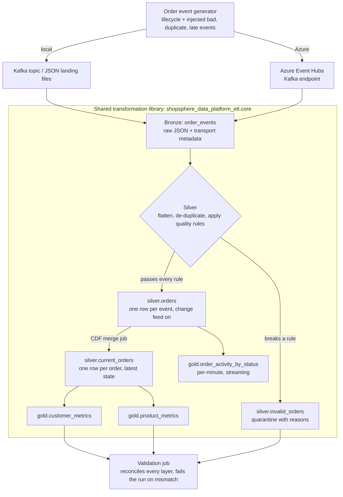

# ShopSphere Data Platform

[](https://github.com/Elisha-s/shopsphere-data-platform/actions/workflows/tests.yml)

A streaming data platform for an e-commerce order feed, built on Azure and the
medallion (Bronze / Silver / Gold) pattern. Order events stream into Azure
Event Hubs, a Databricks pipeline cleans and de-duplicates them, and a
reconciliation job proves at the end of every run that the layers agree.

New to the project? Read the [plain-English walkthrough](docs/walkthrough.md):
seven files make up the deployed platform.

## Tools used, and why

| Tool | What it does here | Why this one |
|---|---|---|
| **Azure Event Hubs** | Receives the order events | Managed streaming service with a Kafka-compatible endpoint, so Spark's Kafka source reads it without a special connector |
| **Databricks Lakeflow Declarative Pipelines** | Builds the Bronze, Silver and Gold tables | Tables are declared, not scripted, and data-quality rules record how many rows failed each one |
| **Delta Lake + Change Data Feed** | Stores every table and lists newly changed rows | Reliable table updates (MERGE), and the merge job reads only new rows |
| **Unity Catalog** | Organises tables into catalogs and schemas | Dev and prod are separated by catalog, with one place for permissions |
| **Databricks Asset Bundles** | Deploys the pipeline and jobs from code | Repeatable deployment from the command line instead of portal clicks |
| **Databricks secret scope** | Holds the Event Hubs access key | The key is never in Git or in configuration |
| **Azure Data Factory** | Runs the stages in order | Managed orchestration with per-stage failure handling, using its own managed identity |
| **GitHub Actions** | Runs lint and tests on every push | Catches breakage before it is merged |

A local version of the same logic (Kafka or JSON files, open-source Spark)
also exists for development and CI. See [Local prototype](#local-prototype).

## Architecture



Stage order, enforced by Azure Data Factory in the cloud and by
`local_pipeline/run_pipeline.py` locally:

**Bronze → Silver → CDF merge → Gold → Validation**

## What has been verified

| Part | Status |
|---|---|
| Transformation library, generator, local streaming stages | Unit tests on every push (`pytest`) |
| Full local pipeline on real Delta tables, including the change feed, MERGE and re-runs | End-to-end test on every push (`pytest -m delta`) and run by hand |
| **Azure**: Event Hubs, Lakeflow pipeline, CDF merge job, Gold, validation job | **Deployed and run end to end on Azure Databricks.** All six reconciliation checks passed: [record of the run](docs/azure-run.md) |
| **Azure Data Factory** pipeline | Imported and run in Debug mode against the deployed workspace; it started each stage in order |
| Kafka and Docker Compose path | Not run in CI. Run by hand only |
| Scheduled triggers, alerts, the `prod` target | Defined or documented, not run |

The Azure environment is created for a demo and deleted afterwards, so it is
not running now. [Deploying to Azure](docs/deployment.md) is the checklist that
was followed, with the problems met on the way written into it.

## What it demonstrates

- **Exactly-one-place data quality.** One rule set drives the Lakeflow
  expectations, the quarantine filter and the per-record failure reasons.
  Every event lands in `silver.orders` or `silver.invalid_orders`, never both,
  never neither.
- **Bounded-state de-duplication** of redelivered events with
  `dropDuplicatesWithinWatermark`.
- **Incremental, idempotent change processing.** The CDF merge job reads only
  unprocessed Delta versions, keeps the newest event per order by event time,
  and guards the MERGE so a late event cannot roll an order back.
- **Late and out-of-order data** handled deliberately at each layer.
- **Reconciliation, not hope.** Each run checks Bronze against Silver, Silver
  against current state, and Gold totals against their source.
- **A generator that exercises all of the above**: orders move through a
  lifecycle, and a configurable share of events is invalid, duplicated or late.
  The tests assert that the pipeline's counts match what the generator injected.
- **Deployment as code**: Databricks Asset Bundles with catalog-separated dev
  and prod, and a parameterised ADF pipeline with per-stage failure handling.

## Deploy to Azure

The Azure resources are not kept running between demos, so deployment starts
from an empty subscription: [docs/deployment.md](docs/deployment.md). What a
real run produced, and what went wrong on the first attempt, is in
[docs/azure-run.md](docs/azure-run.md).

```bash
cd databricks_bundle
export DATABRICKS_CONFIG_PROFILE=<profile>
databricks bundle deploy -t dev \
  --var="catalog=<catalog>" \
  --var="eventhubs_namespace=<namespace>" \
  --var="adf_service_principal_id=<id>"
```

## Tests

```bash
pytest             # fast: transformations, generator, streaming stages (no downloads)
pytest -m delta    # end to end on real Delta tables: change feed, MERGE, saved position
ruff check .
```

What each layer of tests covers, and what is not tested:
[docs/testing.md](docs/testing.md).

## Local prototype

The first version of the project, kept for development and for the tests
that run in CI. It runs the same transformation code on a laptop.

Requirements: Python 3.10 to 3.12 and Java 17. On Windows, use the Docker
option or WSL (local Spark needs extra Hadoop binaries on native Windows).

```bash
python -m venv .venv && source .venv/bin/activate
pip install -r requirements.txt

# 1. Generate two hours of order events (about 5,000) as JSON files
python -m ingestion.run_producer --target files --max-events 5000 --backfill-minutes 120

# 2. Run Bronze -> Silver -> CDF merge -> Gold -> Validation
python -m local_pipeline.run_pipeline --source files

# 3. Look at the results
python -m local_pipeline.show_results
```

The first run downloads the Delta Lake libraries from Maven Central (about a
minute). `make demo`, `make show` and `make more` wrap the same commands.

Run step 1 again with fewer events and then step 2 again to see incremental
processing: only the new files are read, and only new Delta versions are merged.

### With Kafka, in Docker

```bash
docker compose -f local_pipeline/docker/docker-compose.yml up --build
```

This starts Kafka, a Kafka UI on <http://localhost:8080>, a producer sending
five events a second, and the pipeline running every 30 seconds.

More detail: [docs/running-locally.md](docs/running-locally.md).

## Repository layout

| Path | What it is |
|---|---|
| `databricks_bundle/src/shopsphere_data_platform_etl/core/` | Shared business logic: schemas, quality rules, flattening, de-duplication, CDC, metrics |
| `databricks_bundle/src/.../transformations/` | Lakeflow pipeline definitions (thin wrappers around `core`) |
| `databricks_bundle/src/.../jobs/` | CDF merge job and validation job (run on Databricks and locally) |
| `databricks_bundle/resources/`, `databricks.yml` | Databricks Asset Bundle: pipeline, jobs, dev and prod targets |
| `orchestration/adf/` | Azure Data Factory pipeline definition |
| `ingestion/` | Event generator and producers (files, Kafka, Event Hubs) |
| `local_pipeline/` | Local prototype: Spark + Delta runner, results viewer, Docker setup |
| `tests/` | Unit tests and the end-to-end test |
| `docs/` | Architecture, data flow, design decisions, deployment, monitoring, testing |

## Documentation

- [Plain-English walkthrough](docs/walkthrough.md)
- [Architecture](docs/architecture.md)
- [Data flow, table by table](docs/data-flow.md)
- [Design decisions and trade-offs](docs/design-decisions.md)
- [Running locally](docs/running-locally.md)
- [Deploying to Azure](docs/deployment.md)
- [Record of the Azure run](docs/azure-run.md)
- [Monitoring](docs/monitoring.md)
- [Testing](docs/testing.md)
- [ADF orchestration](orchestration/adf/README.md)
